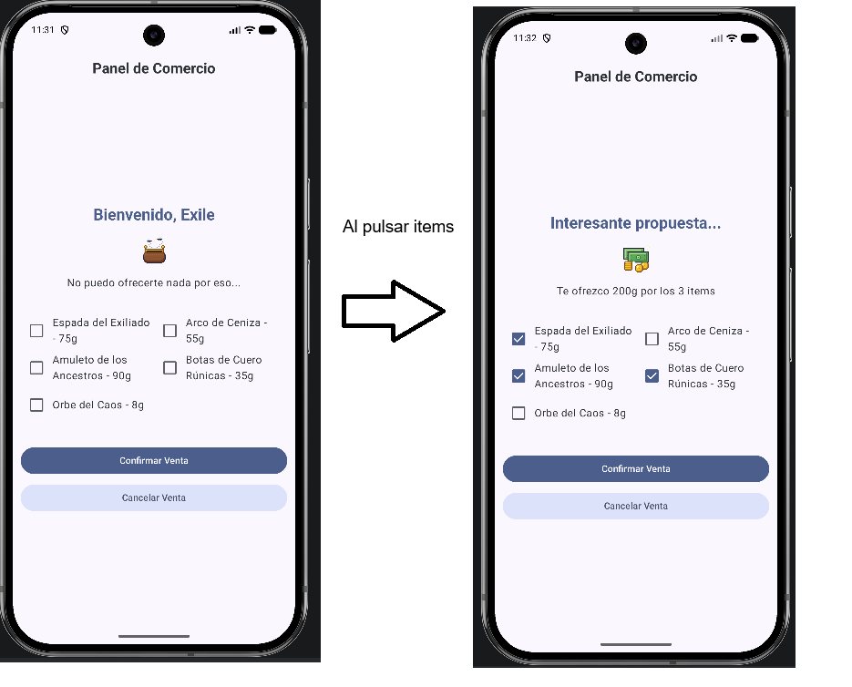

# Simulador de Venta de Inventario

Parcial 1 de la asignatura **Programación de Móviles** (PMDM) del curso 2026-2027.
Grupo 2K.
Módelo B

## Descripción de la app - 
Eres el mercader de un juego de rol (inspirado en el *Path of Exile*). El jugador te ofrece objetos de su inventario, marca los que quiere vender y tú le dices cuánto oro le das por ellos. Toda la app es **una sola pantalla**.

## Rúbrica de evaluación — Simulador de Venta de Inventario

La nota se obtiene por **niveles de cumplimiento acumulativos**. Hay que **completar un nivel entero para que cuente el siguiente**: los puntos de Avanzado solo suman si el Básico está completo, y los de Excelente solo si el Avanzado está completo.

| Nivel     | Nota máxima | Se evalúa si...           |
|-----------|-------------|---------------------------|
| Básico    | 5           | Siempre                   |
| Avanzado  | 8           | Básico completo           |
| Excelente | 10          | Básico y Avanzado completos |

---

### Estructura de la pantalla (de arriba abajo)

```
┌─────────────────────────────────────────┐
│            Panel de Comercio            │  ← TopAppBar
├─────────────────────────────────────────┤
│                                         │
│           Bienvenido, Exile             │  ← Saludo del mercader
│                                         │
│              ┌─────────┐                │
│              │ imagen  │                │  ← Resumen de venta
│              └─────────┘                │     (imagen + mensaje)
│   No puedo ofrecerte nada por eso...    │
│                                         │
│  ☐ Espada del Exiliado  ☐ Arco de       │
│    - 75g                  Ceniza - 55g  │
│  ☐ Amuleto de los       ☐ Botas de      │  ← Grid de checkboxes
│    Ancestros - 90g        Cuero Rúnicas │     (2 columnas)
│                           - 35g         │
│  ☐ Orbe del Caos - 8g                   │
│                                         │
│  ┌───────────────────────────────────┐  │
│  │          Confirmar Venta          │  │  ← Botón principal
│  └───────────────────────────────────┘  │
│  ┌───────────────────────────────────┐  │
│  │          Cancelar Venta           │  │  ← Botón secundario
│  └───────────────────────────────────┘  │
└─────────────────────────────────────────┘
```




### Zonas

1. **TopAppBar**: barra superior con el título **"Panel de Comercio"** centrado y en negrita.
2. **Saludo del mercader**: texto destacado (grande, en negrita y con el color primario del tema).
   - Sin nada seleccionado: **"Bienvenido, Exile"**
   - Con algún objeto seleccionado: **"Interesante propuesta..."**
3. **Resumen de venta**: una imagen centrada y, debajo, un mensaje.
   - Sin nada seleccionado: imagen `sin_premio_monedero` y el texto **"No puedo ofrecerte nada por eso..."**
   - Con selección: imagen `premio_dinero` y el texto **"Te ofrezco Xg por los N items"**, donde X es la suma de los precios y N el número de objetos marcados.
4. **Grid de checkboxes**: un checkbox por cada objeto de `InventoryRepository`, con la etiqueta `Nombre - Preciog`, en **dos columnas**. Si el número de objetos es impar, el último ocupa solo su mitad de la fila.
5. **Botones**: dos botones del ancho de la pantalla, uno debajo del otro.
   - **Confirmar Venta**, con el color primario. Muestra el Toast **"Transacción solicitada"** y deja la pantalla como al principio.
   - **Cancelar Venta**, con el color `secondaryContainer`. Muestra el Toast **"Inventario limpiado"** y deja la pantalla como al principio.

Todo el contenido tiene un **margen de 8 dp** respecto a los bordes de la pantalla.

### Ejemplo de uso

| Acción del jugador | Saludo | Imagen | Mensaje del resumen |
|---|---|---|---|
| Abre la app | Bienvenido, Exile | Monedero vacío | No puedo ofrecerte nada por eso... |
| Marca *Espada del Exiliado* | Interesante propuesta... | Bolsa de oro | Te ofrezco 75g por los 1 items |
| Marca también *Arco de Ceniza* | Interesante propuesta... | Bolsa de oro | Te ofrezco 130g por los 2 items |
| Desmarca *Espada del Exiliado* | Interesante propuesta... | Bolsa de oro | Te ofrezco 55g por los 1 items |
| Pulsa **Confirmar Venta** | Bienvenido, Exile | Monedero vacío | No puedo ofrecerte nada por eso... (+ Toast) |

### Capturas de referencia

Arriba tienes sendas capturas de la app en funcionamiento. La primera muestra la pantalla inicial, y la segunda muestra la pantalla con varios items seleccionados.

> Las capturas muestran la versión **Excelente** (nivel máximo). En el nivel Básico basta con que todos los elementos estén en pantalla. Consulta cada nivel para saber qué tiene que ser dinámico.

---

## Requisitos críticos (sin ellos no se aprueba)

Si falta alguno, el nivel Básico **no se da por superado** y la nota máxima es **4**, aunque la app funcione en función de lo cerca que esté de la versión final.

- [ ] **Componentes separados en `ui.components`**: como mínimo cuatro ficheros o composables independientes. Se te proporcionan vacíos. Si quieres puedes fusionar alguno pero al menos que hayan 3:
  1. Bienvenida (`SaludoMercader`)
  2. Resumen de venta (`ResumenVentas`)
  3. Grid de checkboxes (`CheckboxGrid`)
  4. Botones (`SeccionBotones`)
- [ ] **Nada de UI en `MainActivity`**: la Activity solo llama a la app/pantalla. La composición de la pantalla va en `ui.screens` (`MainScreen`).
- [ ] **Padding global de 8 dp** aplicado al contenido de la pantalla.
- [ ] **El proyecto compila y arranca** sin errores.

---

## Nivel Básico (hasta 5 puntos)

UI completa con todos los componentes y estado mínimo.

| # | Criterio | Puntos |
|---|----------|--------|
| B1 | **Saludo** del mercader visible (texto fijo vale en este nivel). | 0,75 |
| B2 | **Resumen de venta** visible: imagen + texto con el resumen (imagen fija vale en este nivel). | 0,75 |
| B3 | **Grid de checkboxes** con los items del `InventoryRepository` (nombre y precio de cada item). **Vale a una columna.** | 1,5 |
| B4 | **Botones** "Confirmar Venta" y "Cancelar Venta" visibles. | 0,5 |
| B5 | **Estado**: marcar o desmarcar un checkbox actualiza el **número de items seleccionados** que aparece en el resumen. El checkbox refleja el estado (sigue marcado tras pulsarlo). | 1,5 |
|   | **Total** | **5** |

---

## Nivel Avanzado (hasta 8 puntos, +3)

Solo cuenta si el Básico está completo o muy cerca de estarlo.

| # | Criterio | Puntos |
|---|----------|--------|
| A1 | **TopAppBar** con título, dentro de un `Scaffold`, y el `innerPadding` se respeta. | 0,5 |
| A2 | **Toasts** en ambos botones, cada uno con su mensaje. | 0,75 |
| A3 | **Total de oro**: se calcula la suma de precios de los items seleccionados y se muestra en el resumen. | 1 |
| A4 | **Imagen dinámica**: el resumen cambia de imagen (y de texto) según haya algo seleccionado o no. | 0,75 |
|    | **Total** | **3** |

---

## Nivel Excelente (hasta 10 puntos, +2)

Solo cuenta si el Básico y el Avanzado están completos.

| # | Criterio | Puntos |
|---|----------|--------|
| E1 | **Saludo dinámico**: el mensaje de bienvenida cambia cuando hay items seleccionados. | 0,5 |
| E2 | **Los botones limpian el formulario**: tras pulsar Confirmar Venta o Cancelar Venta, se desmarcan todos los checkboxes y el resumen vuelve a su estado inicial (además del Toast). | 0,75 |
| E3 | **Grid a dos columnas** (`LazyVerticalGrid` con `GridCells.Fixed(2)` o equivalente), bien alineado. | 0,75 |
|    | **Total** | **2** |

---

## Ajuste por prácticas de código

Se aplica sobre la nota del nivel alcanzado. La nota final nunca pasa de **10** ni baja de **0**.

### Buenas prácticas (suman hasta +1 punto)

- [ ] Textos en `strings.xml`, no hardcodeados (incluido el título del TopAppBar y los mensajes de los Toast). Te doy algunos ya picados, pero puedes añadirlos tu si prefieres.
- [ ] **State hoisting**: el estado vive en `MainScreen`; los componentes de `ui.components` lo reciben por parámetro y avisan con lambdas (`onCheckedChange`, `onVenderClick`...).
- [ ] Cada componente acepta un `modifier: Modifier = Modifier`.
- [ ] Hay `@Preview` de los componentes.
- [ ] Se espacian los componentes para que no se solapen y quede estético.
- [ ] Nombres claros y coherentes en composables, parámetros y variables.

### Malas prácticas (restan hasta −1 punto)

- [ ] Estado (`remember`/`mutableStateOf`) metido dentro de los componentes de `ui.components` en vez de elevarlo.
- [ ] Datos de inventario copiados a mano en la UI en vez de leerlos de `InventoryRepository`.
- [ ] Valores mágicos repetidos (paddings, tamaños, textos) sin ningún criterio coherente.
- [ ] `stringResource` u otras llamadas `@Composable` dentro de lambdas `onClick` (no compila o fuerza apaños).
- [ ] Código muerto sin sentido, o muchos imports sin usar.

